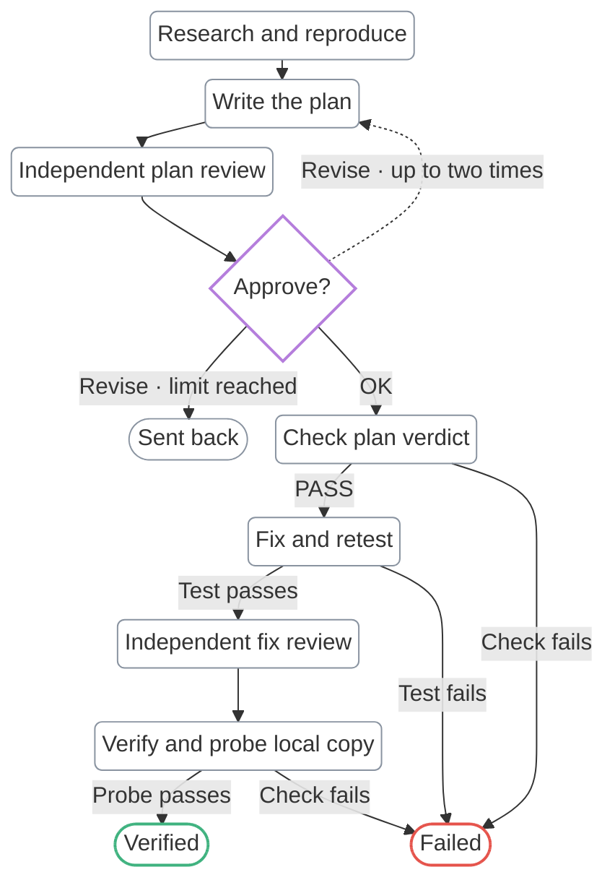
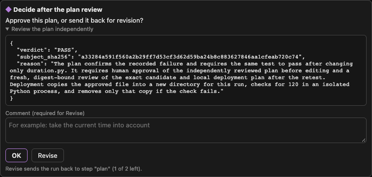
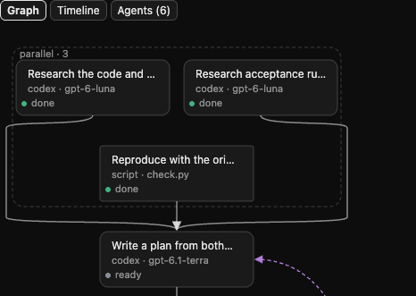
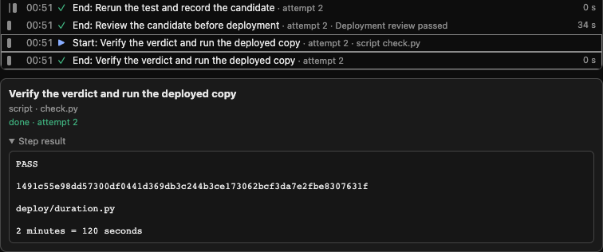
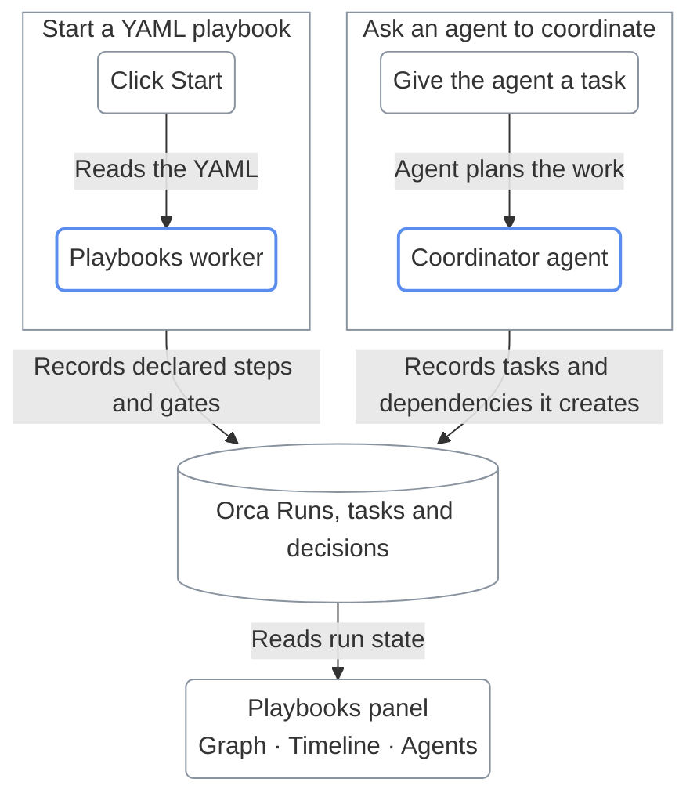

# Playbooks for Orca

An [Orca](https://github.com/stablyai/orca) plugin for running agent workflows
defined in YAML in your repository. Follow each run in a live graph, review
the results, and decide when work can move forward.

A Markdown runbook explains how your team works. A playbook turns the steps,
dependencies, and approvals into rules the plugin follows on each run.
Review changes to those rules in Git, alongside the code they apply to.

[See it run](#human-in-the-loop-example) · [Two ways to coordinate](#two-ways-to-coordinate-work-in-orca) ·
[Install and try it](#quick-start) · [YAML reference](#playbook-format)

## Human-in-the-loop example

**Review-gated fix** takes a software change from investigation through local
deployment. Two agents research the bug while a script reproduces it. The
planner waits for all three results.



The [BPMN model](examples/asdlc/process.bpmn) shows each step and the exits
after approval, testing, and deployment. A failed script at any step stops
the run.

### Define the workflow in YAML

In the [executable playbook](examples/asdlc/.orca/playbooks/review-gated-fix.yaml),
`needs` makes the decision wait for the independent plan review.
**Revise** sends your comment back to the planning step, up to twice in this
example. After **OK**, the next script checks the plan and verdict.

```yaml
  - id: decide
    title: Decide after the plan review
    needs: [review-plan]
    gate:
      question: Approve this plan, or send it back for revision?
    on:
      revise: {goto: plan, max_loops: 2}
  - id: verify-plan
    title: Check the plan verdict and digest
    needs: [decide]
    script: {run: check.py, timeout_sec: 30}
```

### Watch a revision and approval

The first reviewer asked for the exact test command and deployment path.
The operator chose **Revise**, and the plugin kept the research while fresh
agents wrote and reviewed the new plan. The next decision card is shown
here in a replay of the recorded run.



After **OK**, the example's script verified the plan verdict and digest. The
original test passed after the fix, an independent reviewer approved the
candidate, and the local copy returned **`2 minutes = 120 seconds`**.

<details>
<summary>See the full run</summary>

Both research agents and the reproduction script finished before the plan
became ready.



The final script checked the candidate verdict and probed the deployed copy.



</details>

| Who | What they do in this example |
| --- | --- |
| **Agents** | Research, plan, fix, and review. Each step has its own prompt and report. Prompts can read earlier results from the run directory. |
| **Scripts** | Reproduce the bug, rerun the original test, and verify that the verdict matches the plan or candidate. Failed checks block dependent work. |
| **You** | Read the review and choose **OK** or **Revise**. The revision loop returns to the planning step and passes it your comment. |

- [Run this example with Codex](examples/asdlc/README.md) in a standalone demo repository.
- [Read the task briefing](examples/asdlc/task.md) used by the agents.

## Two ways to coordinate work in Orca



**Start a YAML playbook.** You or an agent can operate **Start** in the panel.
The plugin validates the YAML, dispatches ready agent steps, runs scripts,
opens gates, and applies the declared **Revise** loop. The `Playbook: …`
terminal supplies the run's identity in Orca.

**Ask an agent to coordinate.** The agent creates a native Orca Run and
decides which tasks, dependencies, checks, and gates to create. A playbook
shared as instructions gives it a procedure to follow.

In **Run or conversation**, select an Orca Run with recorded dependencies to
see its **Graph**. For work grouped under a conversation, use **Timeline** and
**Agents** to see dispatches and results. [Panel reference](#the-panel)

Paseo uses a Playbook Manager agent by default and offers a managerless mode.
The Orca plugin coordinates YAML runs through its worker. [Manager modes in
Paseo](https://github.com/lerenn/paseo-playbooks#runs-with-no-playbook-manager)

## Requirements

- Orca **1.4.263 or newer** with host API 1.10 (`agents.list` with `workspaceId`). This build was tested
  with the Ubuntu package pinned in CI. Experimental native chat navigation has a separate version
  requirement.
- The Orca CLI set by the app in `ORCA_CLI_COMMAND`. If unset, the plugin uses `orca-ide` on Linux
  and tries the bundled macOS binary before falling back to `orca` elsewhere. On Linux, use
  `orca-ide` in place of `orca` in the commands below.
- `python3` for `.py` script steps, and the agents your playbooks name, set up in Orca.
- Workspaces on this computer only (see Limitations).

## Quick start

Start with a script-only example to see the panel and a decision gate.
The review-gated workflow above has its own [demo setup](examples/asdlc/README.md).

1. Install the plugin from a folder:

   ```sh
   git clone https://github.com/h3x89/orca-playbooks.git
   orca plugin install ./orca-playbooks --json   # lists what it asks for and prints a fingerprint
   orca plugin install ./orca-playbooks --approve <fingerprint>
   ```

   or straight from Git (Orca takes the newest `vX.Y.Z` tag, else the default branch):

   ```sh
   orca plugin install h3x89/orca-playbooks --json
   orca plugin install h3x89/orca-playbooks --approve <fingerprint>
   ```

2. If you installed straight from Git, clone the repository locally to get the examples.
   From the cloned `orca-playbooks` directory, make a demo repository:

   ```sh
   demo=$(mktemp -d)
   mkdir -p "$demo/.orca"
   cp -R examples/.orca/playbooks "$demo/.orca/"
   git -C "$demo" init
   git -C "$demo" add .
   orca repo add --path "$demo"
   ```

   You can also copy the example directory into an existing workspace. The panel reads
   `.orca/playbooks/` in the selected workspace.
3. Open the demo workspace, then the **Playbooks** panel in the right sidebar. Select **Workspace**.
   Click **Refresh** if the panel was open while you copied the files.
4. Pick **Sequential vs parallel** (script steps only, no agent) and press **Start**. Watch the Graph
   and Timeline tabs, then answer the gate with **OK**.
5. Try **Weather research** with Codex configured in Orca. Two agents write reports from fictional
   forecast and air data in parallel. A script combines the reports, an agent drafts a plan for a walk,
   and a separate agent reviews the saved draft. In **Graph**, select the review and open **Step result**. Try
   **Revise** with a comment such as `Make the plan fit a 20-minute walk.` The two research results
   are reused and two new agents draft and review the revised plan. With a passing review, choose
   **OK** and read **Show the approved plan → Step result**. In **Agents**, select a step or choose
   **Show agent** to inspect a session. The first pass uses four Codex sessions and each Revise
   uses two more, up to two revisions.
6. Try **Weather and air**: two scripts fetch the forecast and air quality from
   [Open-Meteo](https://open-meteo.com) (no API key), a Claude agent writes a plan, and you approve it or
   press **Revise** with a comment to have the plan written again.

You can ask an agent already in the demo workspace to walk you through it:

> Open `.orca/playbooks/weather-research.yaml`. Explain which steps run in parallel and how
> to start Weather research in the Orca Playbooks panel. Show me where to read the review,
> how to send the plan back once with Revise, and how to find the approved plan.

## Trust

Install this plugin only if you trust its code, and start only playbooks from repositories you trust.

- The plugin runs as a `trusted-worker`: a Node process with the rights of your user account. It runs
  the `orca` CLI and the scripts of a playbook (`<repo>/.orca/playbooks/scripts/`).
- Script steps get only `PATH`, `HOME`, `USER`, `LANG`, `LC_ALL`, `TMPDIR` and `PLAYBOOK_*` variables.
  This is not a sandbox: a script can do anything your account can.
- An agent step starts an Orca worker on your account with a prompt from the repository. What the agent
  may do depends on that agent's permission settings in Orca; in a permission-bypass mode, a prompt
  alone can run commands. Every agent step uses your subscription or API quota, and Revise runs steps
  again (at most `max_loops` times, up to 5).
- The panel lists every local workspace, including cloned repositories of other people: a playbook from
  someone else's repository looks the same as your own.
- **Last lines** of worker transcripts are shown with a simple mask for strings that look like tokens.
  Take care when sharing screenshots.
- The opt-in chat adapter reads the local Orca runtime credential to select a tab through Orca's
  private local Unix socket. The credential stays in the worker. See [Open an agent chat](#open-an-agent-chat-experimental).
- The plugin has no hooks. It writes run files to `<repo>/.orca/runs/` and saves run state in its own plugin storage.

Capabilities it asks for: `storage:own` (the runs it started), `settings:own` (optional journal and experimental chat settings),
`workspace:read` (the workspace in focus
and the list of workspaces), `workspace:write` (open workspaces and files, focus terminals),
`agent:read` (live agent states), `terminal:send`, `notifications:show`. Orca describes `terminal:send`
broadly (open and close terminals, type and run commands in your terminals, local and over SSH); the
plugin uses it only to open the coordinator terminal of each run it starts.

`ORCA_CLI_COMMAND`, when set in Orca's environment, replaces the `orca` binary the plugin calls; it is
meant for development and the tests.

## The panel

The panel opens on **Workspace**. **Needs you** groups open decisions by repository, and its count
stays visible across the tabs. Select **Open decision** to go to the gate. After answering a gate
opened from **Needs you**, the panel returns to the list.
**Catalog** groups saved playbooks by local repository and shows their workspace or branch.
**Open playbook** selects that YAML in its workspace. Click **Start** there to run it.

**Workspace** follows the workspace selected in Orca's left sidebar (**Pin** keeps it on one). It shows:

- the playbooks of the workspace and **Start**;
- **Run or conversation**: playbook runs, conversations of this workspace that started agents, and other
  Orca Runs whose workers worked here;
- the same tab row for each of them: **Graph | Timeline | Agents (N)**.

| Tab | Playbook run | Orca Run started by an agent | Conversation |
| --- | --- | --- | --- |
| Graph | steps and `needs`, live states, the Revise loop | tasks and their dependencies; without dependencies, a note instead of a graph | a note: a conversation declares no dependencies |
| Timeline | task created, worker started, questions, reports, gates, decisions and ends, with durations; bars on the left show who worked in parallel | the same | first prompt when available, plus worker events and follow-ups across Runs |
| Agents | agent steps with model, state, start and duration | tasks a worker took | workers with their dispatch date and number of rounds |

Where the Graph tab has no graph, it says why and how to get one: describe the work as a playbook in
`.orca/playbooks/` and start it from the panel. Hover over a graph step or focus it from the keyboard
to see its full name, state, and dependencies it is waiting for. Select a graph step, a Timeline row
or an agent to preview its result. **Details** jumps to the step's actions. Depending on the step,
these include **Open script**, **Open result file**, **View result**, **Last lines**, **Open terminal**
and **Open decision**. Recorded agent attempts show their report and last lines. Each script attempt
keeps its own output preview. If an older script attempt has no saved preview, the panel marks it as
unavailable. Opening a file from the current attempt uses Orca's editor.

A decision card appears above the tabs when a gate waits for you, and a banner when one waits in another
workspace. Orca notifications and the status bar item say when a run waits for you, fails, is sent back
or finishes.

### Open an agent chat (experimental)

In **Settings → Plugins → Playbooks → Details**, turn on **Experimental: Open native chat**.
The setting defaults to off and this adapter works with **Orca 1.4.274 desktop on Linux**.
It applies to native chats already open on that desktop.

Open a playbook run and choose **Open chat** on an agent's **Graph** card or next to its attempt
on **Timeline**. After **Revise**, each attempt opens its own chat tab. If the chat tab is closed,
you can still use **Last lines** or **View result**.

The adapter is a temporary workaround using Orca's private local interface and may need updating
when Orca changes it. Playbooks will move to a supported action when Orca provides one.
[Follow the native chat focus request (#42069)](https://github.com/stablyai/orca/issues/42069).

### First prompt and parallel work

In **Settings → Plugins → Playbooks**, set **Local Orca journal path** to the absolute path
of this installation's `agent-session-domain.db` to enable first-prompt times. On a standard macOS
installation the path is `~/Library/Application Support/orca/agent-session-domain.db`. The worker
needs an SQLite CLI with JSON output and `-safe` support on its PATH. It queries the local journal in read-only mode
and returns only timestamps for the workspace's Orca sessions. The setting is empty by default.
Older conversations show a time when the journal still has the original submission. A missing or
incompatible journal leaves the time absent. Clear the setting to turn this off. This fallback is
temporary pending [Orca's first-prompt timestamp API](https://github.com/stablyai/orca/issues/47231).

Expand **What do the bars show?** to read the Timeline key. The full bar belongs to the step
in the row, and thinner bars show other work at the same time. Amber marks work in progress.
Timeline colors the event icons for starts, completions, decisions and failures. In **Agents**,
the dot beside each name shows its state. **Superseded** marks downstream steps replaced
before they started. **Sent back · Revise** highlights the decision.

### Conversations and their agents

Orca records which conversation dispatched each orchestration task: `dispatch.creator_orca_session_id`
in `orca orchestration dispatch-show --task <id>`. The plugin reads it for recent Runs (the 60 newest in
`run-list`) and puts every agent a conversation started, in any of those Runs, under that conversation.
A Run dispatched by a conversation of the selected workspace is not listed again on its own. A decision
gate nobody dispatched belongs to the conversation when it is the only one dispatching in that Run.

A conversation's state reads "waiting for you · last reply HH:MM", "waiting for its helpers" or
"working". The panel also shows the work Orca observes inside a session right now (background commands,
native subagents); Orca keeps no history of it.

## Playbook format

A playbook is `<repo>/.orca/playbooks/<name>.yaml`; its scripts live in `<repo>/.orca/playbooks/scripts/`.
Results of a run go to `<repo>/.orca/runs/<run_id>/` (the plugin adds a `.gitignore` there).

```yaml
title: Weather and air
description: Shown under the playbook in the panel.
inputs:                      # optional fields with defaults
  activity: { default: running }
steps:
  - id: weather
    script: { run: weather.py, timeout_sec: 120 }   # .py runs with python3, .sh with /bin/sh, others directly
  - id: plan
    needs: [weather]
    agent: claude            # claude, codex, opencode, opencode2, cursor, antigravity, grok, muse, zcode, pi, omp
    model: claude-sonnet-5-5 # optional; effort only together with model
    keep_open: true          # optional: the worker's terminal stays open after the work
    prompt: |
      Today is {{date}}, the time is {{now}}. Read {{run_dir}}/weather.txt and write a plan.
  - id: decision
    needs: [plan]
    gate: { question: Approve the plan? }
    on:
      revise: { goto: plan, max_loops: 2 }   # Revise with a comment runs plan again
```

- A step has exactly one of `agent`, `script`, `gate`; `id` is lowercase letters, digits, `-` or `_`;
  at most 40 steps; `needs` must not form a cycle.
- An agent step writes its result to `{{run_dir}}/<id>.md` (the plugin adds this to the prompt, with
  "do not commit or push" and how to report back). A script step's result is its last stdout line
  `{"outputs": {...}}` when there is one, else all of stdout, saved to `{{run_dir}}/<id>.txt`.
- Variables in prompts: `{{run_dir}}`, `{{date}}` and `{{now}}` (system time zone), `{{step}}`,
  `{{comment}}`, `{{inputs.<name>}}`. The comment of a Revise is also appended to the prompt of the step
  that runs again.
- `on.revise.goto` must name a step the gate depends on; that step, every step between it and the gate,
  the gate and everything after it run again. On Revise, a gate without `on.revise`, or with no loops
  left, ends the run as sent back.

### Ask for a ticket at start

```yaml
inputs:
  ticket:
    label: Ticket
    description: Enter the issue ID, for example DEMO-123.
    required: true
    format: ticket
```

The panel displays a field above **Start**. An empty or invalid ticket stops the
start before an Orca Run is created. A prompt can read `{{inputs.ticket}}`
and a script can read `PLAYBOOK_INPUT_TICKET`. Each run keeps its own values.
Input fields also accept `default`; existing defaults still prefill the form.

A run is an ordinary Orca Run, so agents and scripts can read it with
`orca orchestration task-list --run <run_id>` and `gate-list --run <run_id> --full`. Start runs and
answer gates from the panel: `orca orchestration gate-resolve` from another terminal fails with
"Gate not found", because Orca looks for the gate in the caller's Run. If a gate is resolved some other
way, the plugin still reads the decision; it accepts only `ok` or `revise: <comment>` and asks again on
any other answer.

## Limitations

- Workspaces on this computer only: workspaces on SSH hosts and paired Orca servers are not listed.
- Native subagents (for example Claude Code's Agent tool) are shown only while Orca observes them live;
  they are not on the Timeline or the Agents tab.
- No **Abandon** or **Retry step** button. A worker that fails to start fails its step and is not
  retried. If the coordinator terminal is closed or Orca restarts, a run can stay "running" with an
  error; disabling the plugin stops it from being polled.
- Every **Start** opens a terminal named "Playbook: …". It is the run's identity in Orca (`--from`) and
  runs only `cat >/dev/null`, so a notification Orca types into it is never run by a shell. Close it
  when the run is over.
- The plugin keeps the 20 newest playbook runs.
- It reads JSON from `orca orchestration … --json`; a change in those commands in a later Orca release
  can break parts of the panel.

## Development

```sh
./scripts/check.sh         # also runs in GitHub Actions
orca plugin types .        # writes the Orca typings to .orca/types/
```

The checks use the installed Orca CLI (`orca-ide` on Linux), Node.js 22 or later,
Python 3, Git, and the SQLite CLI. They validate the manifest and example
playbooks, check BPMN parity, and exercise the parser, timeline, and full runs
against a fake Orca CLI. The checks run without opening the desktop app.

Run **CI** manually with **Run the desktop smoke test under Xvfb** to try the
same plugin inside Orca on Ubuntu. The **Revise and publish** demo uses a fresh
profile and only script steps. It checks that **Revise** reruns the draft,
publication waits for **OK**, and the final file matches the result in the
panel. The run includes a screenshot and a summary of the checks.

The repository is public, and so is every commit and pull request: read `AGENTS.md` before changing it.

## Uninstall

```sh
orca plugin list                     # the plugin key: local.playbooks from a folder, h3x89.playbooks from Git
orca plugin uninstall <plugin-key>
```

Close any "Playbook: …" terminals that are still open. You can delete `<repo>/.orca/runs/`. Runs and
tasks stay in Orca's orchestration history.

## Acknowledgements

Repository-defined playbooks, approval gates, and revision loops were inspired
by [Paseo Playbooks](https://github.com/lerenn/paseo-playbooks).

## License

MIT, see `LICENSE`. The YAML parser in `vendor/yaml` is yaml 2.9.1 (ISC). The way the worker calls
`orca orchestration` follows [Agent Pipeline](https://github.com/Alexander-64/orca-pipeline) (MIT); no
code is copied. Details in `NOTICE`.
